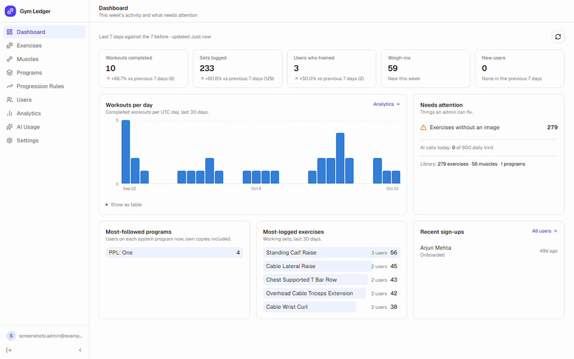
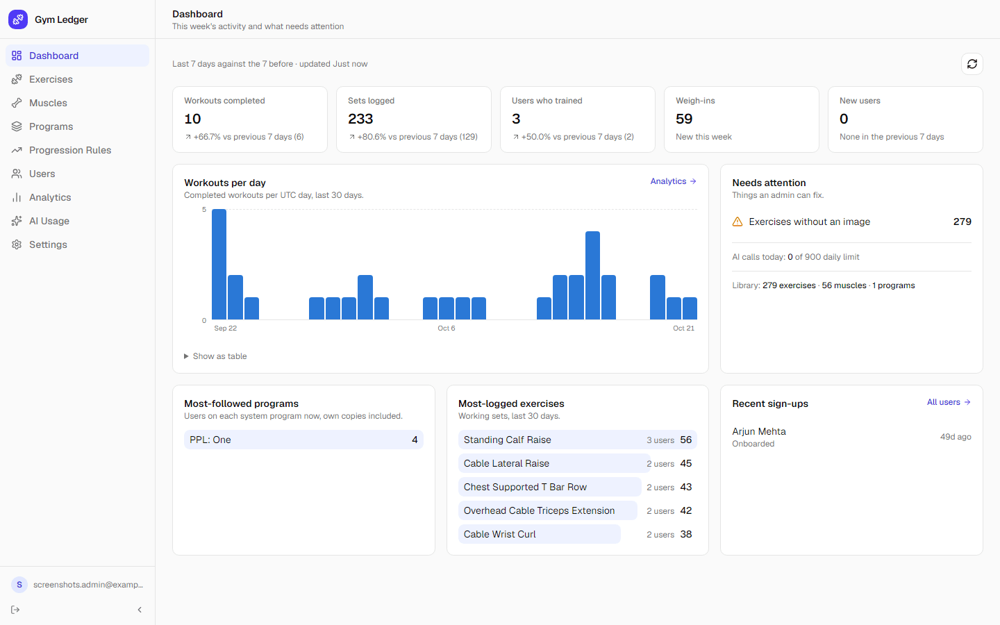
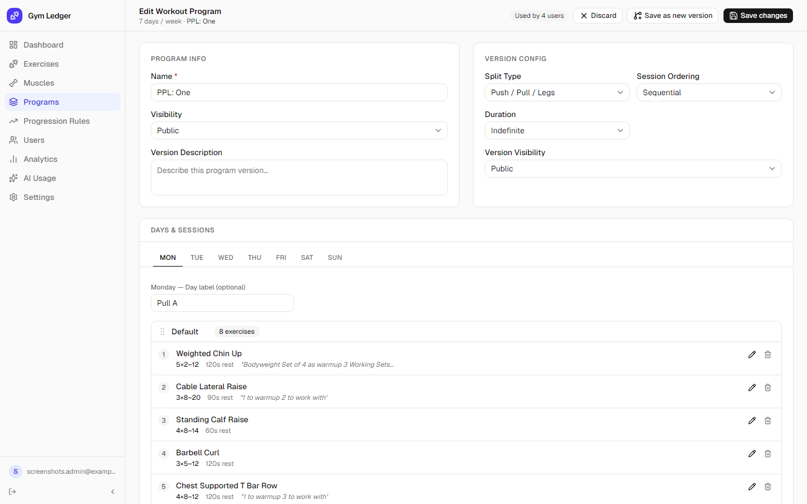
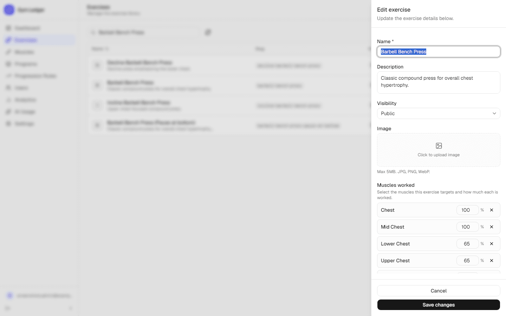
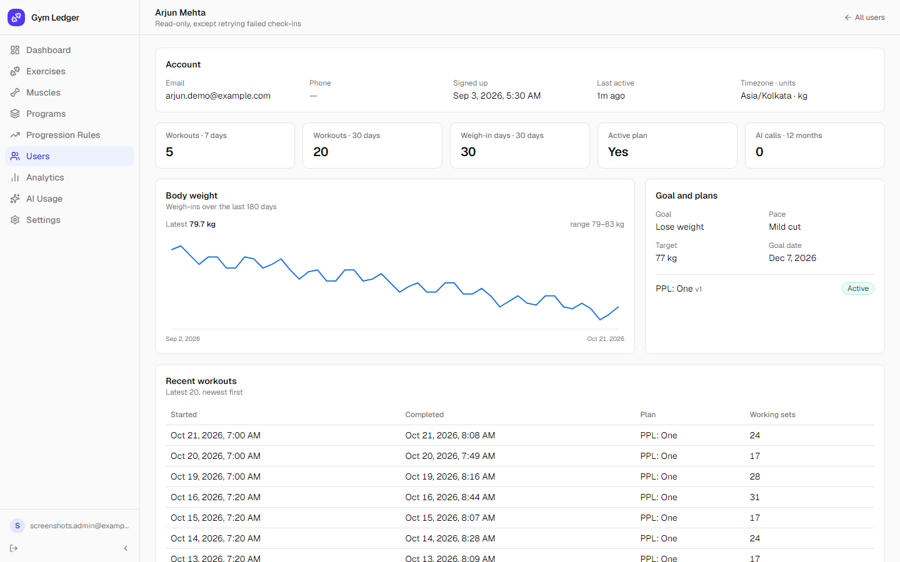

# gym-ledger/admin

The Gym Ledger admin panel: where the people running an instance manage the exercise library and the system workout plans, and keep an eye on users, activity and AI usage. Desktop-first, dense, built for operators.

Part of Gym Ledger, alongside [`gym-ledger/api`](https://github.com/gym-ledger/api) (the API every app talks to) and [`gym-ledger/web`](https://github.com/gym-ledger/web) (the app people train with).

## Screenshots

<p align="center"></p>

| Dashboard | Program builder |
|---|---|
|  |  |
| **Exercise editor** | **User detail** |
|  |  |

The data shown belongs to a demo account.

## Features

- **Dashboard.** This week against last week, workouts per day, what needs attention, the most-used plans and exercises, and recent sign-ups (contact details masked).
- **Exercises.** Create and edit exercises with the muscles each one works and how much (0–100%), an image, and public/private visibility. Import and export the whole library as CSV; a re-import of an edited export updates the same exercises.
- **Muscles.** The muscle hierarchy (groups and their parts) behind the muscle map in the app, with CSV import and export.
- **Workout programs.** A builder for system plans: days, sessions within a day, and per-exercise targets (sets, rep range, RIR, rest, tempo, notes). Saving as a new version keeps everyone on the old version unaffected until they choose to update.
- **Progression rules.** Define double progression, static load, RIR-based and other rules. (Not yet applied in the user app.)
- **Users and analytics.** Search and filter users by activity, see one user's training and check-in history, retry a failed AI check-in, and see AI request volume and outcomes over time.
- **Account.** Change your password, and see every device signed in to your account (up to 5 at once) with sign-out per device or for all others.

Every change made here (creates, edits, deletes, imports, password changes, signing devices out) is recorded by the API in an audit log: who, from which session and IP, what, and when.

## Tech stack

| Layer | Technology |
|---|---|
| Framework | Next.js 16 (App Router) · React 19 · TypeScript |
| Styling | Tailwind CSS 4 · shadcn/ui · Radix UI |
| Tables | TanStack Table |
| Data | TanStack Query · Zustand |
| Forms | React Hook Form · Zod |
| Deployment | Docker (Next.js standalone output) |

## Run it

The quickest way to run the whole project (database, API, the user app and this panel) is the one-command stack in the API repository: see [Run the whole stack](https://github.com/gym-ledger/api#run-the-whole-stack). It creates a first admin you can sign in with.

To work on this panel alone against an API that is already running:

```bash
cp .env.example .env.local   # then set NEXT_PUBLIC_API_URL
npm install
npm run dev                  # http://localhost:3000 (3001 in the stack)
```

| Script | What it does |
|---|---|
| `npm run dev` | Development server with hot reload |
| `npm run build` | Production build |
| `npm run start` | Serve the production build |
| `npm run lint` | ESLint |

Admins are created on the API side: the first one from `DEFAULT_ADMIN_EMAIL` / `DEFAULT_ADMIN_PASSWORD` when the API starts with none. There is no sign-up.

## Configuration

| Variable | Required | What it is |
|---|---|---|
| `NEXT_PUBLIC_API_URL` | yes | Public URL of the API, ending in `/api/v1`, as the browser reaches it. Read at build time. |

Exercise images are stored by the API on S3-compatible storage (Cloudflare R2, AWS S3, MinIO, …); set the `S3_*` variables on the API to turn uploads on.

## Project layout

```
src/
├── app/(admin)/    one route per section: dashboard, exercises, muscles, programs, …
├── features/       per-section components, hooks, services (API calls) and types
├── components/     shared layout (sidebar) and shadcn/ui
├── auth/           token handling, refresh across tabs, sign-out
└── lib/            the API client
```

## Deployment

See the [deployment guide](deployment/DEPLOY.md). On a server set up with the API's `deployment/ci/setup-server.sh`, every push to `main` deploys to production through GitHub Actions, and every push to `qa` to the QA server. Consider keeping the panel off the public internet (a VPN, or an IP allow-list in your reverse proxy).

## Contributing and security

See [CONTRIBUTING.md](CONTRIBUTING.md). Please report vulnerabilities privately as described in [SECURITY.md](SECURITY.md).

## License

[MIT](LICENSE)
